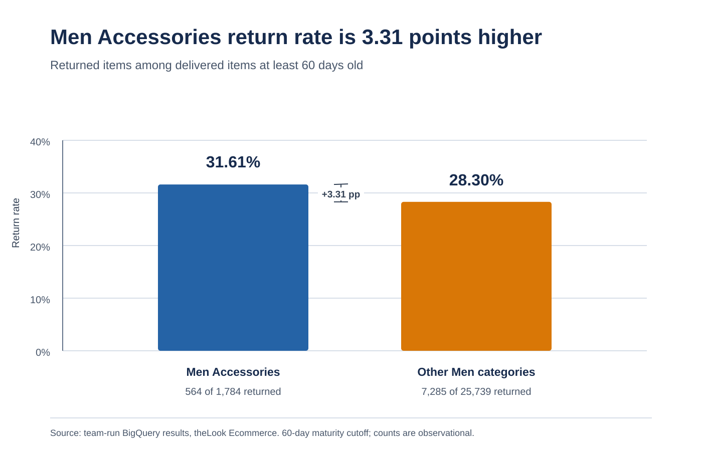

# CP1 Findings: Men Accessories Return Rate

## Measured gap

Team-provided BigQuery results show a higher return rate for mature delivered Men Accessories items than for all other Men categories.

| Group | Returned | Mature delivered items | Rate |
|---|---:|---:|---:|
| Men Accessories | 564 | 1,784 | 31.61% |
| Other Men categories | 7,285 | 25,739 | 28.30% |
| Difference | - | - | **3.31 percentage points** |

The peer rate is pooled: total returns divided by total items in all other Men categories. Both groups use the same 60-day maturity rule. This is an observed association, not evidence that category causes returns.

## Row grain and data preparation

One row is an `order_items.id`, joined to `products.id` through `order_items.product_id`. We include delivered items only if `delivered_at` is at least 60 days before the query date; a non-null `returned_at` marks a return. The 60-day rule is our analysis choice, not a verified store policy.

The team's quality result covered 54,922 mature delivered joined rows: 54,922 distinct item IDs, no missing or unmatched product IDs, no missing or negative sale prices, no return-before-delivery dates, and no future return dates. Delivery dates ranged from 2019-01-11 to 2026-09-12 in that cohort. See [query 02](sql/02_return_data_quality.sql) and [audit log](Other/audit_log.md).

## Value estimate

At the peer rate (28.3034%), 1,784 items would yield about 504.93 returns. The observed 564 returns exceed this by **59.07 items** (about 59). The focus group's returned sale-price total was 24,245.02 across 564 returns, an average of about 42.99. Multiplying 59.07 by 42.99 gives about **2,539.20 sale_price units**.

This is gross sale-price amount associated with the excess count under the benchmark assumption. Results do not establish currency, profit margin, refund amount, resale value, or recoverability. It is not annualized.

## Gap chart

## Managerial implication
A manager could review return reasons, fit and descriptions, and item-level patterns in Men Accessories. This comparison identifies where to investigate; it does not identify a driver or prove which intervention would work.

## Sources and limits
Counts and rates are from the team's BigQuery results for `order_items` joined to `products`; result CSVs remain outside the repository. Gap and value arithmetic are agent calculations from those reported counts and totals. The cutoff and benchmark are project choices. See [dataset documentation](Other/dataset_documentation.md) and [query notes](sql/README.md).
