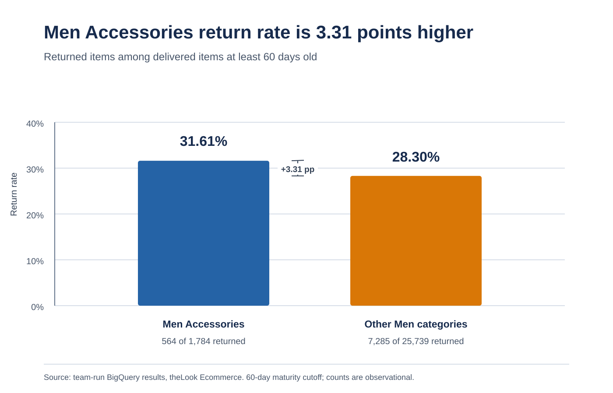

# CP1 Findings: Men Accessories Return Rate

## Measured gap

The executed benchmark uses category `Accessories` within department `Men`; “Men Accessories” is its output label.

Team-provided BigQuery results show a higher return rate for mature delivered Men Accessories items than for all other Men categories.

| Group | Returned | Mature delivered items | Rate |
|---|---:|---:|---:|
| Men Accessories | 564 | 1,784 | 31.61% |
| Other Men categories | 7,285 | 25,739 | 28.30% |
| Difference | - | - | **3.31 percentage points** |

The peer rate is pooled: total returns divided by total items in all other Men categories. Both groups use the same 60-day maturity rule. This is an observed association, not evidence that category causes returns.

## Row grain and data preparation

One row is an `order_items.id`, joined to `products.id` through `order_items.product_id`. We include delivered items only if `delivered_at` is at least 60 days before the query date; a non-null `returned_at` marks a return. The 60-day rule is our analysis choice, not a verified store policy.

The team's quality result covered 54,922 mature delivered joined rows: 54,922 distinct item IDs, no missing or unmatched product IDs, no missing or negative sale prices, no return-before-delivery dates, and no future return dates. Delivery dates ranged from 2019-01-11 to 2026-09-12 in that cohort. See [quality query](sql/10_mature_cohort_quality_check.sql) and [audit log](Other/audit_log.md).

## Value estimate

At the peer rate (28.3034%), 1,784 items would yield about 504.93 returns. The observed 564 returns exceed this by **59.07 items** (about 59). The focus group's returned sale-price total was 24,245.02 across 564 returns, an average of about 42.99. Multiplying 59.07 by 42.99 gives about **2,539.20 sale_price units**.

This is gross sale-price amount associated with the excess count under the benchmark assumption. Results do not establish currency, profit margin, refund amount, resale value, or recoverability. It is not annualized.

## Gap chart

## Managerial implication
A manager could review return reasons, fit and descriptions, and item-level patterns in Men Accessories. This comparison identifies where to investigate; it does not identify a driver or prove which intervention would work.

## Sources and limits
Counts and rates are from the team's BigQuery results for `order_items` joined to `products`; result CSVs remain outside the repository. Gap and value arithmetic are agent calculations from those reported counts and totals. The cutoff and benchmark are project choices. See [dataset documentation](Other/dataset_documentation.md) and [query notes](sql/README.md).

## CP2 analysis-table checks

Brylle's Query 13 result reports 27,307 unique order items. It found no invalid return labels, unsettled deliveries, negative sale prices or ages, missing prices/ages/categories, or unmatched users. Twenty-five source brand values were missing; the table represents them as `Unknown` and keeps a missingness flag. The observed price range is 1.50–999.00 units and ages range from 12 to 70; these ranges are not verified business limits. The table includes 14 Men categories, with 1,700 Accessories items. See [Query 13](sql/13_cp2_analysis_table_checks.sql). These checks describe data quality, not return-rate differences.
## CP2 category and time splits
Agent calculations from Brylle's Query 14 CSV show 478/1,700 Men Accessories items returned (28.12%), versus 7,298/25,607 other Men items (28.50%), a -0.38 percentage-point gap. Thus, the CP1 positive gap does not repeat in this CP2 cohort; its 60-day cutoff was later, so the cohorts differ. By year, the Accessories gap changes direction (for example, +13.77 points in 2020 on 55 Accessories items, and -5.02 points in 2022 on 142); 2026 is partial. Treat small-year comparisons as descriptive. See [Query 14](sql/14_category_return_rates_by_year.sql).
## CP2 brand comparison
Query 15 returned 1,273 brand values. Agent aggregation found 844 values with fewer than 10 items (128 with one item), while 62 values had at least 100 items. Brand-specific return rates are unadjusted; very small brand groups are too sparse for confident ranking. The model plan should address these rare levels before interpreting brand coefficients. See [Query 15](sql/15_return_rate_by_brand.sql).
## CP2 sale-price comparison
Query 16 grouped items into five rank-based sale-price quintiles. The return rates were 28.49%, 28.10%, 28.44%, 29.06%, and 28.29%; the range is 0.96 percentage points with no steady increase or decrease. This is a one-X descriptive comparison, not evidence of a strong price relationship or a causal effect. Price values are not confirmed currency.
## CP2 customer-age comparison
Query 17 reports return rates for each age from 12 through 70. Agent aggregation gives 29.21% for ages 12–20 (1,213/4,153 items) and 28.47% for ages 60–70 (1,476/5,185); individual-age rates fluctuate, so the univariate results do not show a clear steady age pattern. The model will assess age while accounting for the other approved Xs. See [Query 17](sql/17_return_rate_by_age.sql).
## CP2 model evaluation
Brylle's Query 19 output reports 72.20% accuracy, 0 precision, 0 recall, 0 F1, log loss 0.5918, and ROC AUC 0.5138. Query 20's confusion matrix shows 3,961 actual non-returns and 1,525 returns in 5,486 evaluation items, with every item predicted as a non-return. The majority-class baseline is therefore 3,961/5,486 = 72.20%, exactly matching accuracy. The classifier does not improve on the baseline and did not identify any evaluation returns; it is not ready for a business prediction decision. This is a calculation from the team-shared CSVs, not a causal conclusion. See [Query 19](sql/19_evaluate_return_logistic_model.sql), [Query 20](sql/20_return_model_confusion_matrix.sql), and [model card](model/model_card.md).

## CP2 adjusted associations
Query 21's standardized coefficients show no clear adjusted association for Men Accessories (p=0.3522), customer age (p=0.3934), or sale price (p=0.7908). The smallest unadjusted brand p-values are 2(x)ist (-0.6934, p=0.0148), Perry Ellis (+0.3737, p=0.0319), and Volcom (-0.2759, p=0.0377), each compared with the Other reference brand. There are 63 brand contrasts; an agent-calculated Bonferroni threshold is 0.00079, and none meets it. Treat the nominal brand findings as exploratory rather than confirmed drivers. This is an adjusted observational analysis, not evidence of causation. See [Query 21](sql/21_return_logistic_model_weights.sql), [the complete result CSV](model/return_logistic_weights_query21_results.csv), and [model card](model/model_card.md).
